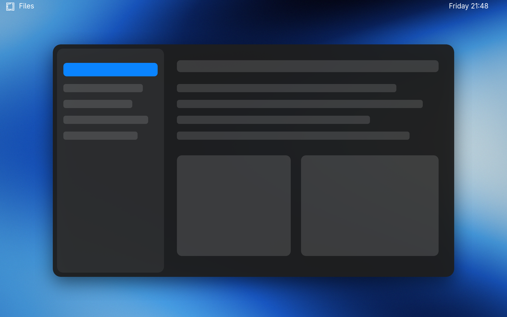

# macOS Tahoe for Omarchy

A dark Omarchy theme inspired by macOS 26 Tahoe: Apple system colors, hairline window borders, and Liquid Glass–style menus, panels, notifications and launcher.

Light variant: [omarchy-macos-tahoe-light-theme](https://github.com/hoangkim28/omarchy-macos-tahoe-light-theme).



## Install

```sh
omarchy theme install https://github.com/hoangkim28/omarchy-macos-tahoe-theme
```

For the full look, install the Inter font, WhiteSur icons and the Apple cursor:

```sh
omarchy pkg add inter-font
omarchy pkg aur add whitesur-icon-theme apple_cursor
```

The theme sets the `WhiteSur-dark` icon theme. Without that package, GTK falls back to its default icons.

## Wallpaper

The repository ships an original abstract wallpaper. Apple's macOS Tahoe wallpapers are not included because they are Apple's copyrighted work. To use them, download the official *macOS Tahoe 26* dark wallpaper yourself and put it in:

```
~/.config/omarchy/backgrounds/macos-tahoe/
```

Then pick it with `omarchy theme bg-switcher`.

## Optional extras: the macOS window look

A theme can only set colors and shell surfaces. The rest of the look lives in `extras/` and is opt-in:

```sh
git clone https://github.com/hoangkim28/omarchy-macos-tahoe-theme
./omarchy-macos-tahoe-theme/extras/install.sh
```

| File | What it does |
| --- | --- |
| `macos.lua` | 14px squircle corners, soft shadows, glass blur on shell surfaces, macOS-like animations, macOS cursor. Loaded last from `~/.config/hypr/hyprland.lua`. |
| `20-macos-tahoe-chrome` | `theme-set` hook. Hides window buttons and titlebars (GTK, libadwaita, Electron, Chromium, VS Code, Obsidian, Ghostty, Kitty) and switches the menu bar, cursor and UI font. |
| `bar-macos.json` | Transparent menu bar: Omarchy menu and active app on the left, status icons and a `Fri 13 Nov  21:48` clock on the right. |

All of it applies **only** while `macos-tahoe` or `macos-tahoe-light` is active. When you switch to another theme, the hook restores your own bar, cursor and font, and Hyprland falls back to your `looknfeel.lua`. Each side keeps its own snapshot in `~/.config/omarchy/macos-tahoe/`, so edits you make on either side are kept.

To remove the extras, delete `~/.config/hypr/macos.lua`, the `require("hypr.macos")` line in `hyprland.lua`, and `~/.config/omarchy/hooks/theme-set.d/20-macos-tahoe-chrome`.

The Omarchy dock is left untouched.

## Not affiliated with Apple

macOS is a trademark of Apple Inc. This is an unofficial fan theme.

## License

MIT, see [LICENSE](LICENSE).
